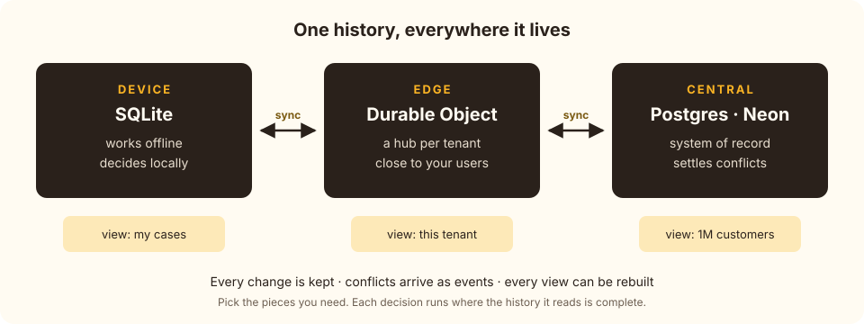

# happenstance

**Your data stays true, everywhere it lives.**

happenstance is the data layer for Rust apps that run on devices, at the edge
and in the cloud. Every change is kept, every business rule is checked, and
every answer can be explained, whether the data sits in SQLite on a laptop that
is offline, in a Cloudflare Durable Object near your users, or in Postgres and
Neon.

*Nothing lost. Nothing wrong. Nothing unexplained.*

[](https://github.com/Wet-Ink-Corporation/happenstance/actions/workflows/ci.yml)
[](https://crates.io/crates/happenstance)
[](https://docs.rs/happenstance)
[](https://wet-ink-corporation.github.io/happenstance/)
[](#minimum-supported-rust-version)

**[Read the guide](https://wet-ink-corporation.github.io/happenstance/)** · [API reference](https://docs.rs/happenstance) · [Examples](#examples) · [Roadmap](#roadmap)

---

## Why happenstance

Apps no longer live in one database. Data is written on a phone with no signal,
at the edge next to the user, and in a central database that has to agree with
both. Sync engines make that fast, but they merge conflicts away and keep no
past, so the data drifts and nobody can say why. Event-sourcing frameworks keep
the past, but they live on one server and bring aggregates, sagas and a vendor
with them.

happenstance keeps both halves. Every change is an event; events sync between
the places your app runs; each decision checks the rules it depends on; and any
view of the data can be rebuilt from the history.

### True offline

Every device keeps its own log and keeps working without a network. When it
reconnects, every change syncs, and nothing is lost or overwritten, because a
change is a fact rather than a row to fight over.

### True to your rules

Seat limits, balances, quotas and unique names are checked at the moment of the
write, across every record the rule touches, with no locks and no sagas. When
two places act at once, you are told, with an event, never left with a silent
mistake.

### True to its history

The log is the source of truth. See why any record looks the way it does,
rebuild a view that went wrong, add a new one over years of data, and change
your event format without a migration.

### True wherever it lives

SQLite on the device, Durable Objects at the edge, Postgres or Neon in the
middle. The same Rust code runs on each of them, and every store passes the
same published conformance suite. It is a library over your own databases, with
no sync service in the middle.

## What you can build

Pick the pieces your app needs. Every arrangement keeps the same guarantees.



| You want | How it looks | Status |
|---|---|---|
| An app that works offline and syncs when it is back | Each device keeps a SQLite log that syncs with Neon or Postgres | ✅ today |
| Many clients and one source of truth | Every device syncs to a central store; conflicts arrive as events | ✅ today; automatic conflict handling in 0.7 |
| Each client holding only its own workspace | One store per workspace, case or tenant; a client syncs the ones it holds | ✅ today |
| Huge views that stay on the server | A server-side read model, queried over HTTP, with read-your-writes | ✅ today ([`tickets-over-http`](examples/tickets-over-http)) |
| A small local view of a big central store | A projection reads the central log and keeps a local SQLite view | ✅ today |
| Rules that span several things | One read and one conditional write, across any entities | ✅ today ([`handles-and-quotas`](examples/handles-and-quotas)) |
| A lean device and a complete cloud | The device prunes history the hub has confirmed | 🛣️ 0.7 |
| Edge hubs close to your users | A Durable Object per tenant, syncing devices nearby and forwarding to Neon | 🛣️ roadmap |

[Choose a topology](https://wet-ink-corporation.github.io/happenstance/guide/choose-a-topology/)
explains each shape and the rule it keeps, [choosing a store](https://wet-ink-corporation.github.io/happenstance/guide/choose-a-store/)
walks through where each piece can run, and [running on a Durable Object](https://wet-ink-corporation.github.io/happenstance/guide/run-on-a-durable-object/)
covers the edge.

## Quick start

```console
cargo add happenstance
cargo add happenstance-sqlite   # when you want the log on disk
```

Append an event and read it back:

```rust
use happenstance::{Event, EventStore, MemoryEventStore, Query, ReadOptions, Tags, collect};

async fn define_course() -> Result<(), Box<dyn std::error::Error>> {
    let store = MemoryEventStore::new();

    store
        .append(
            &[Event::new("CourseDefined", &br#"{"capacity":2}"#[..])?
                .with_tags(Tags::from_pairs([("course", "c1")])?)],
            None,
        )
        .await?;

    let events = collect(store.read(&Query::all(), ReadOptions::new())).await?;
    assert_eq!(events.len(), 1);
    Ok(())
}
```

Then [your first encounter](https://wet-ink-corporation.github.io/happenstance/guide/first-encounter/): three short programs
that end with the store refusing a write that would have broken a rule.

## How your rules stay true

A course holds thirty seats, and a student takes at most five courses. The two
limits are about different things, so in most event-sourced systems one of
them ends up enforced by a separate copy of the data and a background process
that undoes mistakes.

Here a decision reads exactly the events it depends on, across as many entities
as it needs, and its write is accepted only if nothing matching that read has
been added since. The technique is called a
[dynamic consistency boundary](https://wet-ink-corporation.github.io/happenstance/guide/what-is-dcb/) (DCB).

```rust
use happenstance::{
    AppendCondition, Event, EventStore, Query, QueryItem, Tags, read_decision_model,
};

async fn subscribe<S: EventStore>(
    store: &S,
    subscribed: Event,
) -> Result<(), Box<dyn std::error::Error>>
where
    S::Error: std::error::Error + 'static,
{
    // Everything this decision depends on, in one query.
    let query = Query::from_items([
        // The capacity, and everyone currently holding a seat.
        QueryItem::new(
            ["CourseDefined", "StudentSubscribed", "StudentUnsubscribed"],
            Tags::from_pairs([("course", "c1")])?,
        )?,
        // This student's own history with this course.
        QueryItem::new(
            ["StudentSubscribed", "StudentUnsubscribed"],
            Tags::from_pairs([("course", "c1"), ("student", "s1")])?,
        )?,
    ])?;

    let (events, last_seen) = read_decision_model(store, &query).await?;
    // ... fold `events` into a decision ...

    // Append only if nothing matching has landed since we looked.
    let condition = AppendCondition::new(query).after_every_guard_opt(last_seen);
    store.append(&[subscribed], Some(&condition)).await?;
    Ok(())
}
```

No aggregate, no saga, and one append that is refused precisely when something
happened that could have changed the answer. Run the full version with
`cargo run -p course-subscriptions`.

Both Rust blocks on this page are compiled by CI, so neither can drift from the
API.

## Examples

Each runs on a real SQLite file except the first, and none depends on another.

```console
cargo run -p course-subscriptions      # the canonical rule across two things, in memory
cargo run -p transfers-on-sqlite       # commands and a read model on one file, read back after restart
cargo run -p handles-and-quotas        # unique names, per-owner quotas and idempotent delivery
cargo run -p tickets-over-http         # an HTTP API and a projection runner in two processes
cargo run -p rebuilding-read-models    # backfill, promote, reset and rebuild views
cargo run -p telemetry-across-codecs   # one log, two encodings, an old event shape upcast on read
```

## Is it for you?

**A good fit** when your rules span several records, when you need to explain
how data got the way it is, when your Rust code runs on devices, at the edge or
on servers (or all three), and when you want to choose your database later.

**Look elsewhere** for collaborative text editing (Automerge), for a reactive
local database in a JavaScript web app (LiveStore, PowerSync, Zero), or for a
standalone event-store server (KurrentDB, UmaDB).
[Disintegrate](https://github.com/disintegrate-es/disintegrate) is the other
Rust DCB library, Postgres-only and macro-driven.

## Roadmap

| | |
|---|---|
| **Today** | Typed events, decision models and projection runners; SQLite, Postgres, Neon and Durable Object stores; sync between stores over one edge at a time |
| **0.7** | Retention: devices that keep less than the hub, and a report when a peer has been away too long; automatic conflict adjudication |
| **1.0** | Frozen sync, a runner that links several edges, and a stable promise for every surface |
| **Exploring** | SQLite in the browser, as the offline end of sync |

The plan, phase by phase, is in [the runbook](runbook/README.md).

## Status

Pre-1.0, on crates.io, and precise about what it claims. The `EventStore`
contract has been frozen under semver since `0.2.0` and `ProjectionStore`
since `0.3.0`; sync is published and still growing. Every store has passed the
conformance suite; none has production mileage yet.

| Crate | What it is | Status |
|---|---|---|
| [`happenstance`](crates/happenstance) | Typed events, codecs, decision models and projection runners: the crate an application uses | ✅ |
| [`happenstance-core`](crates/happenstance-core) | The storage contract and an in-memory store: the crate an adapter implements | ✅ |
| [`happenstance-sqlite`](crates/happenstance-sqlite) | SQLite event store and projection store | ✅ passes the suite on a real file |
| [`happenstance-postgres`](crates/happenstance-postgres) | Postgres event store and projection store | ✅ passes the suite against a live server, 64 concurrent writers included |
| [`happenstance-neon`](crates/happenstance-neon) | Postgres over one-shot HTTP, for serverless and `wasm32` | ✅ passes the suite against a live endpoint |
| [`happenstance-cloudflare`](crates/happenstance-cloudflare) | Event store inside a Durable Object, on `wasm32` | ✅ passes the suite in a real Durable Object |
| [`happenstance-sync`](crates/happenstance-sync) | Replication between stores: the peer port, the runner and network peers | 🚧 growing |
| [`happenstance-testkit`](crates/happenstance-testkit) | The conformance suite every store must pass | ✅ pin it exactly |
| [`happenstance-sync-testkit`](crates/happenstance-sync-testkit) | Conformance suites for sync peers | 🚧 pin it exactly |

Each crate's README says exactly what its tick covers. Read them before you
rely on one.

## How we know it works

- **A published conformance suite.** An adapter that has not passed
  `happenstance-testkit` is not an adapter, and each rule is paired with a wrong
  store that fails it. [Writing your own store](docs/pass-conformance-suite.md)
  means inheriting the whole suite in one line.
- **A specification in numbered clauses.** [`spec/SPECIFICATION.md`](spec/SPECIFICATION.md)
  marks each clause frozen, provisional or deferred, and names the rule that
  checks it.
- **Documentation the gate compiles.** Every Rust example in the guide and on
  this page is compiled, and the guide's are run, before a change merges.
- **Measurements with their raw data.** About 34 µs to check a rule spanning two
  things on SQLite, about 57,000 events a second appended in batches, and 64
  concurrent writers with exactly one winner and no errors.
  [`benchmarks/results/GRADES.md`](benchmarks/results/GRADES.md) has the method,
  the raw output and what the numbers do not show.

## Minimum supported Rust version

**1.97.1.** Raising it is a breaking change before `1.0.0`; after it, a rise
ships only in a minor release, only to a Rust stable at least six months old,
and always with a `CHANGELOG.md` entry
([ADR-0067](.kb/decisions/0067-msrv-after-1-0-rises-are-bounded.md)).

## Contributing

[`CONTRIBUTING.md`](CONTRIBUTING.md) covers the gate (`cargo xtask ci`), how to
write an adapter, the design principles the contract follows, and where the
name comes from.

## Licence

Dual-licensed under [MIT](LICENSE-MIT) or [Apache-2.0](LICENSE-APACHE), at your
option. If happenstance is useful to you,
[buy the maintainer a coffee](https://buymeacoffee.com/ryanbritton).
